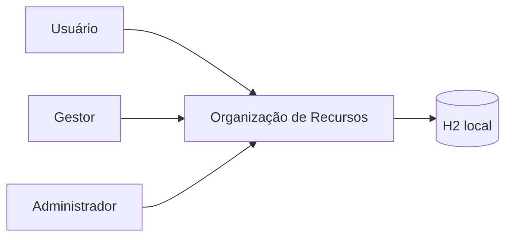
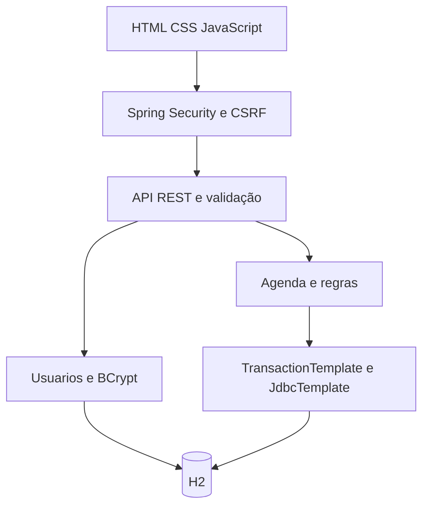
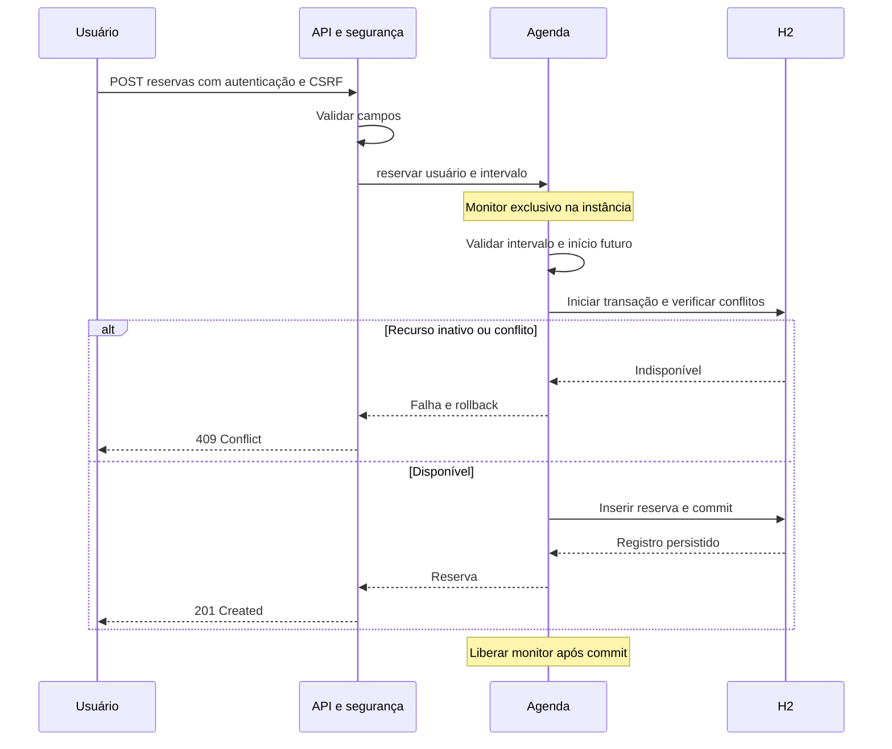
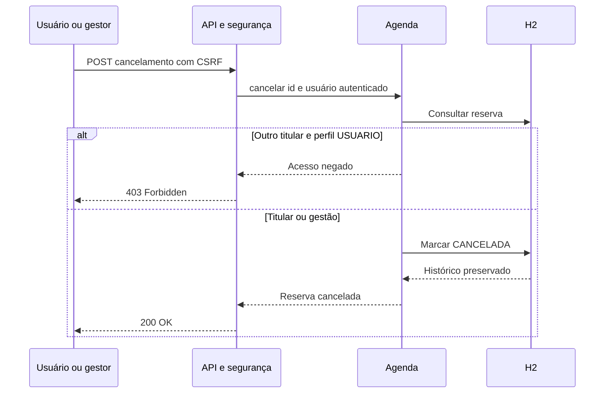
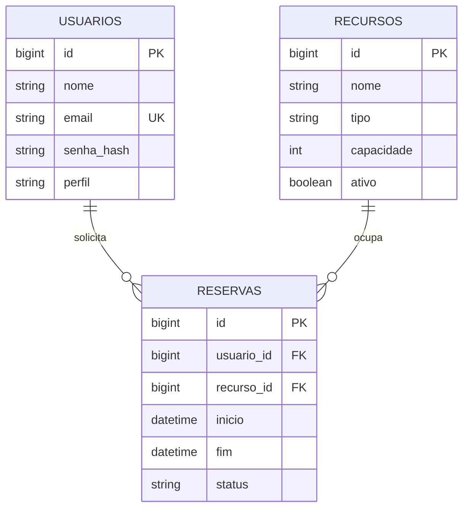

# Arquitetura

## Contexto

## Componentes

## Sequência crítica: reserva

## Sequência crítica: cancelamento

## Modelo resumido

Campos completos em [schema.sql](../src/main/resources/schema.sql).

## Decisões e consequências

| ID | Decisão | Motivo e consequência |
|---|---|---|
| ADR01 | Java 21 e Spring Boot 3.5.16 | Testes e segurança integrados; CI em Java 21, execução local em Java 23 |
| ADR02 | JDBC e H2 em arquivo | Sem serviço externo para reproduzir; não representa banco distribuído |
| ADR03 | Monitor cobrindo TransactionTemplate | Impede janela entre validação e commit numa instância; não cobre escritas externas ou múltiplas JVMs |
| ADR04 | OffsetDateTime | Comparações por instante; frontend converte data local do dispositivo para UTC |
| ADR05 | HTTP Basic e CSRF padrão do Spring Security | Evita token próprio; exige HTTPS fora de localhost e inclui custo BCrypt por requisição |
| ADR06 | Histórico CANCELADA preservado | Cancelamento idempotente; exclusão de recurso com histórico é rejeitada |

O servidor escuta 127.0.0.1 por padrão. Não há HTTPS, rate limiting ou garantia distribuída. A arquitetura não autoriza declarar prontidão de produção.
